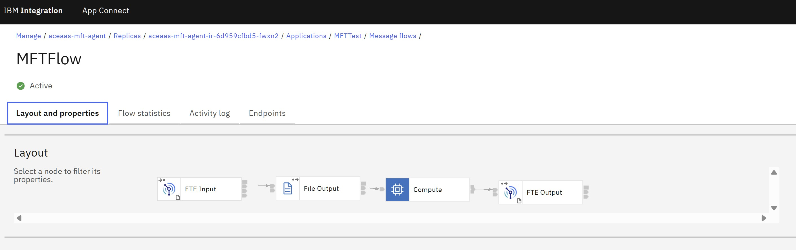

This repo contains examples for configuring an ACEaaS Integration Runtime to work with a MQ SaaS MFT enabled Queue Manager

## Run this against your MQSaaS Queue Manager
[ACEaaS_AGENT_Queues.mqsc](ACEaaS_AGENT_Queues.mqsc): This needs to be run against your MQSaaS Queue Manager using runmqsc. Any occurrences of ACEAAS_AGENT in this file need to be replaced with your Agent name as specified in the server.conf.yaml.

## These are the configurations needed to be set on your Integration Runtime

[server.conf.yaml](server.conf.yaml): Server.conf.yaml configuration which defines the remote MQSaaS Queue Manager, security and FTEAgent configuration

[MFTSAASDEMO.zip](MFTSAASDEMO.zip): Policy project configuration which defines the remote queue manager connection information

[mftqmgruser](mftqmgruser): Your setdbparms.txt configuration which sets the MQSaaS Queue Manager password eg "mq::MFTSAASDEMO domstorey \<Your IBM Cloud API key\>" for the ACE core MQ Client connection.

[agent-config.zip](agent-config.zip) ([unzipped contents](agent-config/)): Generic Files configuration which defines the coordination queue manager ([coordination.properties](agent-config/coordination.properties)), connection queue manager ([command.properties](agent-config/command.properties)), agent queue manager ([agent.properties](agent-config/agent.properties)) and [MQMFTCredentialsForACE.xml](agent-config/MQMFTCredentialsForACE.xml) (which contains the MQSaaS username and password and keystore password) zipped in a directory called 'agent-config'. This is referenced from your server.conf.yaml and used for the MFT/ FTE Java MQ client connection.

key.jks: Your keystore configuration pkcs12 file containing the qmgr cert and any other CAs needed, used by the FTE Agent Java MQ Client

key.kdb: Your keystore configuration used by the ACE core MQ Client connection.

key.sth: Your keystore configuration hash used by the ACE core MQ Client connection.

## Example Message Flow source project
This is a message flow project which you can import into your ACE toolkit: [MFTTest_project_src.zip](MFTTest_project_src.zip) and this is the generated bar file from this project ([MFTTest_project.bar](MFTTest_project.bar)) which you can deploy to your Integration Runtime which connects an FTEInput node as a source and sends content to an FTEOutput node on another DEST_AGENT.

When deployed on an Integration Runtime this flow will start the App Connect Embedded MFT (FTE) Agent using the configurations above and the server.conf.yaml.

